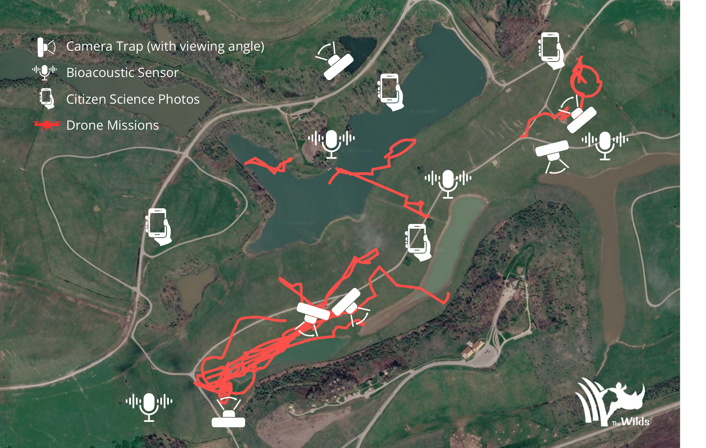
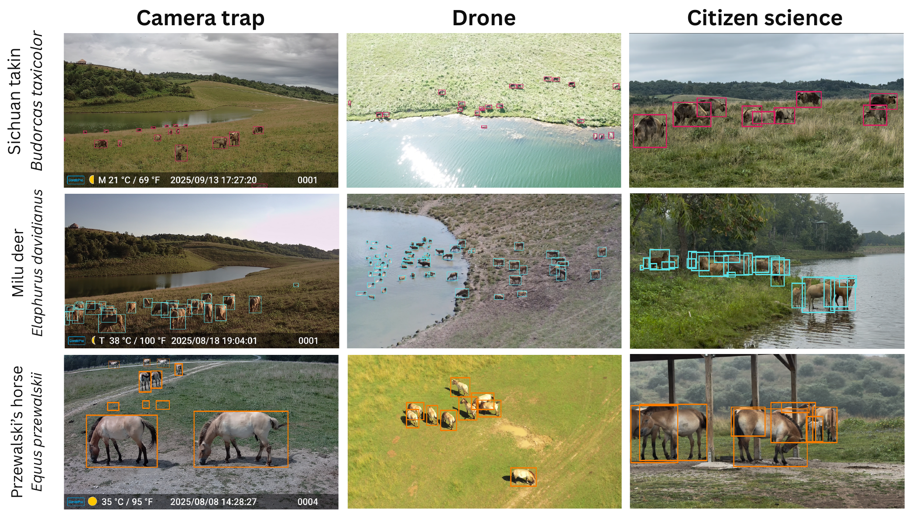

# SmartWilds

[](https://imageomics.github.io/smartwilds/)

SmartWilds is a multi-modal sensing dataset recorded with camera traps, acoustic
recorders, drones, and visitor photographs at [The Wilds](https://thewilds.columbuszoo.org/)
(Cumberland, Ohio) in summer 2025. This repository is the home of the SmartWilds
code and documentation. The first release is the metadata: Darwin Core tables
for all four modalities on one Event hierarchy, with corrected timestamps and
coordinates so they can be joined in space and time, the record of every defect
found and repaired, and the code that did it. Raw images, recordings, and labels
will be released soon and documented here as well.

**Documentation site:** <https://imageomics.github.io/smartwilds/>


*Sensor deployment across The Wilds: camera traps with viewing angles, Song Meter recorders, citizen-science photo locations, and drone flight tracks. Satellite imagery © Google.*


*The same three managed focal species (Sichuan takin, Milu deer, Przewalski's horse) observed by camera trap, drone, and citizen-science photography.*

## Camera-trap release (2026-11-08)

The current camera-trap release (`smartwilds-camera-traps`) contains 72,775
retained Occurrences with original SAM3 geometry on 19,785 camera Events, and
the full 235,778-image inventory. The merged multimodal tables contain 22,242
Events and 401,602 unique Occurrences. See
[`docs/CAMERA_TRAP_RELEASE.md`](docs/CAMERA_TRAP_RELEASE.md) for the
annotation method and provenance.

- **Data:** [imageomics/smartwilds_metadata](https://huggingface.co/datasets/imageomics/smartwilds_metadata) on Hugging Face, in the
  [SmartWilds collection](https://huggingface.co/collections/imageomics/smartwilds)
- **Field protocols, forms, and logs:**
  [Imageomics/naturelab](https://github.com/Imageomics/naturelab)
- **Paper:** *SmartWilds: Integrating, Aligning, and Documenting Multi-Modal
  Field Sensing Data* (under review)
- **Earlier release:** the 2025 four-day pilot release,
  [arXiv:2509.18894](https://arxiv.org/abs/2509.18894)

## What is here

| Path | Contents |
|---|---|
| `docs/SUPPLEMENTAL.md` | The paper's supplemental material: glossary, per-deployment inventories, the 18 timestamp-repair methods, drone ground projection, standards crosswalk, typed missingness, model accuracy, validation checks, field dictionary, and arrival statistics |
| `docs/DEFECT_INVENTORY.md` | All 22 defect classes found during integration: scope, what detected each, the repair, and the residual risk |
| `docs/CAMERA_TRAP_RELEASE.md` | Scope and label provenance of the 2026-11-08 camera-trap release |
| `docs/AGENT_ASSISTED_DOCUMENTATION.md` | How LLM coding agents were used to inventory, document, and quality-check the data, and the guidelines they were given |
| `metadata/` | The dataset cards (the `smartwilds_metadata` card and the five component cards), the defect inventory, the per-device sensor configurations, and the card images |
| `guidelines/` | Local copies of the FAIR² Drones documentation standard the cards follow, for use as agent context |
| `field_campaigns/` | Data summaries and per-campaign data reports (field logs and protocols live in [Imageomics/naturelab](https://github.com/Imageomics/naturelab)) |
| `scripts/README.md` | What each script does, its inputs and outputs, and the environment variables it reads |
| `scripts/darwin_core/` | Darwin Core Event and Occurrence generator, and raw-WAV reconciliation |
| `scripts/georeferencing/` | Camera-trap (pinhole model) and drone (ground-ray) projection, with their configs |
| `scripts/validation/` | Release audit: parent links, parsed dates/times/coordinates, sentinel rejection, media resolution |
| `scripts/arrival_traces/` | Versioned acquisition- and detection-layer arrival traces |
| `scripts/privacy_screening/` | MegaDetector person screening, triage by identifiability, and a review-first drone launch/landing trim plan |
| `analysis/cross_modal_coordination/` | Code and derived data of *A Blueprint for Cross-Modal Coordination at the Far Edge*: workload characterization, synthesis, four coordination case studies, fidelity checks, and the hardware feasibility grid. An example of the planning analyses the metadata enables |
| `examples/quickstart.py` | Load the tables, apply a verification floor, walk the Event hierarchy, and extract a drone frame |
| `examples/join_camera_acoustic_by_site_hour.py` | Join camera-trap and acoustic Occurrences by site and hour across campaigns |

## Quickstart

```bash
pip install -r requirements.txt
huggingface-cli download --repo-type dataset imageomics/smartwilds_metadata --local-dir smartwilds_metadata
python examples/quickstart.py smartwilds_metadata/smartwilds-camera-traps
```

Pass several dataset folders to combine modalities. They share one Event
hierarchy, rooted at `TheWilds_2025`.

## Using the data correctly

- **Pick a verification floor before analysis.** Almost every Occurrence is a
  machine label, and the status vocabulary differs by table. The current
  camera release has 70,728 `triage_resolved`, 1,807 `triage_reviewed`, 199
  `triage_forced_1nn`, 39 `human-edit`, and two `human-reviewed` labels; every
  retained camera box has original SAM3 geometry. Drone and acoustic labels are `unverified`
  or `validated`; the 12 human-added drone starling boxes are
  `human-supported; limited-resolution`. The drone labels come from BioCLIP 2
  (the TreeOfLife-200M model, `imageomics/bioclip-2`) run in its open-world
  Tree of Life mode, which predicts a taxon with its full rank hierarchy rather
  than choosing among a fixed label list; species-rank accuracy on
  human-annotated subsets is 0.271 and class-rank accuracy is 0.845. A seven-video human-annotated drone reference
  set (27,159 boxes) is described in `docs/SUPPLEMENTAL.md` S9.
- **Occurrences are detection crops, not individuals.** Bursts and adjacent
  drone frames repeat the same animal.
- **Use the corrected timestamps.** Camera clocks were wrong on most
  deployments, and burned-in overlays show the raw clock. Every image carries
  its correction method and confidence.
- **Report your choices.** State the unit of observation, the verification
  floor, and the timestamp policy alongside any derived metric. See the paper's
  discussion of statistical validity.

## Reproducing the release

The scripts record the pipeline as it was run against the field archive.
Input locations come from environment variables (`SMARTWILDS_ARCHIVE` for the
archive root, `SMARTWILDS_DWC_OUT` for the generated tables, and a few
script-specific ones); `scripts/README.md` lists them. Given the same inputs the
tables are regenerated deterministically:

```bash
export SMARTWILDS_ARCHIVE=/path/to/TheWilds2025
python scripts/darwin_core/generate_darwin_core.py --force
python scripts/validation/audit_darwin_core_snapshot.py --root "$SMARTWILDS_DWC_OUT"
python scripts/arrival_traces/generate_arrival_traces_v2.py
```

Packaging the tables into the per-modality Hugging Face datasets is done in the
project's internal release staging and is not part of this repository.

Person screening needs a GPU and MegaDetector v5a (`pip install megadetector`).
`scripts/privacy_screening/run_screening.sh` is the SLURM job we used.

## Related repositories

Field logs and protocols live in [Imageomics/naturelab](https://github.com/Imageomics/naturelab).
The earlier working repository, `Imageomics/wilds_multimodal_data`, is
preserved here under the `legacy/wilds_multimodal_data/` branch prefix; see
[Related repositories](https://imageomics.github.io/smartwilds/legacy/).

## Citation

Please cite the paper and each modality dataset you use (`CITATION.cff`).

```bibtex
@article{kline2026smartwilds,
  author  = {Kline, Jenna M. and Potlapally, Anirudh and Campolongo, Elizabeth G.},
  title   = {SmartWilds: Integrating, Aligning, and Documenting Multi-Modal Field Sensing Data},
  year    = {2026},
  note    = {Under review. Supplemental material: https://imageomics.github.io/smartwilds/SUPPLEMENTAL/}
}
```

## Papers using SmartWilds

```bibtex
@inproceedings{kline2026blueprint,
  author    = {Kline, Jenna and Potlapally, Anirudh and Subramoni, Hari and Berger-Wolf, Tanya and Stewart, Christopher},
  title     = {A Blueprint for Cross-Modal Coordination at the Far Edge},
  booktitle = {ACM/IEEE Symposium on Edge Computing (SEC)},
  year      = {2026},
  note      = {To appear}
}

@inproceedings{pillai2026cross,
  author    = {Pillai, Bharath and Viswapriyan, Varun and Stewart, Christopher and Berger-Wolf, Tanya and Kline, Jenna},
  title     = {Cross-Modal Corroboration for Annotation-Free Wildlife Monitoring},
  booktitle = {CV4Animals Workshop at the IEEE/CVF Conference on Computer Vision and Pattern Recognition (CVPR)},
  year      = {2026}
}
```

If you publish work that uses SmartWilds, open an issue or pull request and we
will add it here.

## License

Code: MIT (see `LICENSE`). Data: [CC0 1.0](https://creativecommons.org/publicdomain/zero/1.0/) for all five datasets, following the
[Imageomics licensing policy](https://imageomics.github.io/Imageomics-guide/wiki-guide/Digital-products-release-licensing-policy/).

## Acknowledgements

This project is supported by the [Imageomics Institute](https://imageomics.org), which is funded by the US National Science Foundation's Harnessing the Data Revolution (HDR) program under [Award #2118240](https://www.nsf.gov/awardsearch/showAward?AWD_ID=2118240) (Imageomics: A New Frontier of Biological Information Powered by Knowledge-Guided Machine Learning), and by the [AI Institute for Intelligent Cyberinfrastructure with Computational Learning in the Environment (ICICLE)](https://icicle.osu.edu/), which is funded by the US National Science Foundation under [Award #2112606](https://www.nsf.gov/awardsearch/showAward?AWD_ID=2112606).

This work is also supported by the AI and Biodiversity Change (ABC) Global Center. The ABC Global Center is funded by the US National Science Foundation under [Award No. 2330423](https://www.nsf.gov/awardsearch/showAward?AWD_ID=2330423&HistoricalAwards=false) and the Natural Sciences and Engineering Research Council of Canada under [Award No. 585136](https://www.nserc-crsng.gc.ca/ase-oro/Details-Detailles_eng.asp?id=782440). This dataset draws on research supported by the Social Sciences and Humanities Research Council.

Any opinions, findings and conclusions or recommendations expressed in this material are those of the author(s) and do not necessarily reflect the views of the National Science Foundation, Natural Sciences and Engineering Research Council of Canada, or Social Sciences and Humanities Research Council.

Special thanks to Dan Beetem and [The Wilds](https://www.thewilds.org/) in Ohio for providing access to deployment sites and supporting this wildlife monitoring research. We thank the Columbus Zoo and Aquarium for their support in facilitating this project. All data collection, including drone flights, was conducted under the supervision of the Director of Animal Management, with permission from The Wilds Animal Care and Use Committee.

This work used the [Ohio Supercomputer Center](https://www.osc.edu/) (Ohio Supercomputer Center, 1987, <http://osc.edu/ark:/19495/f5s1ph73>).

## Contact

Jenna M. Kline (kline.377@osu.edu)
