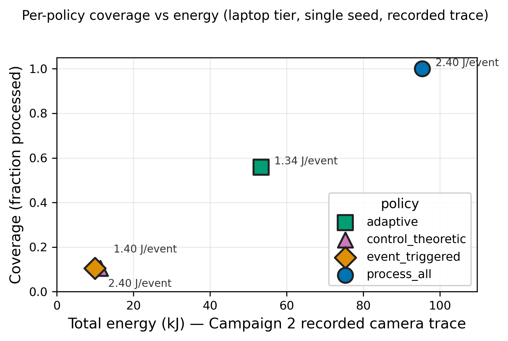
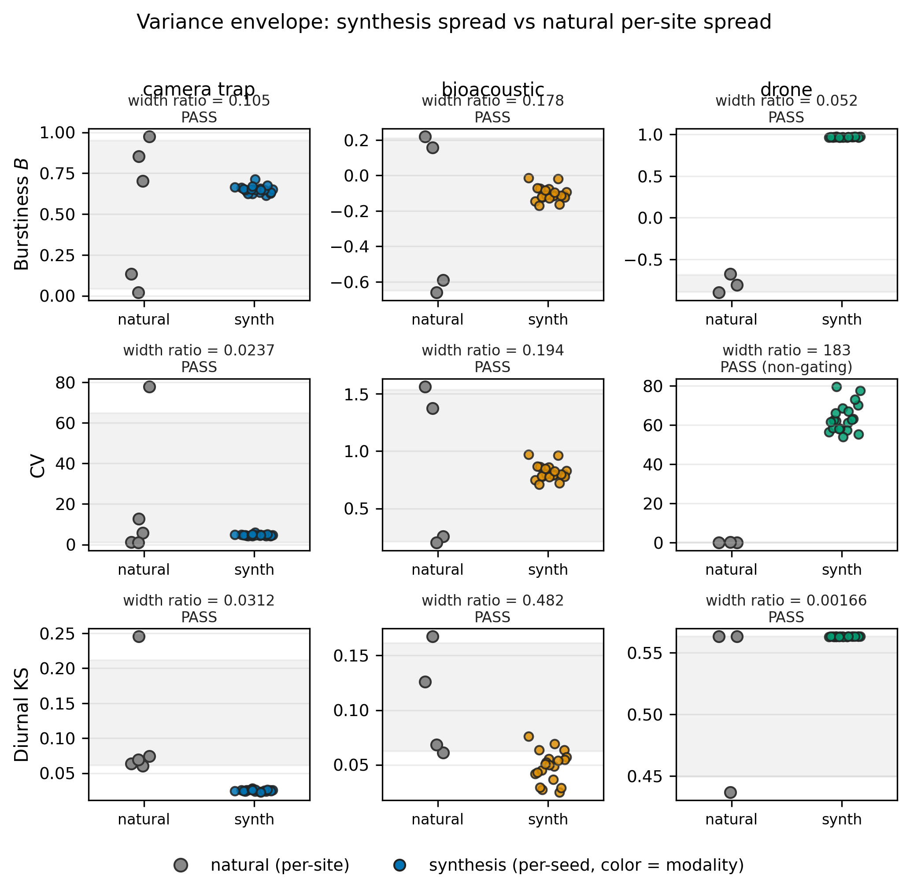
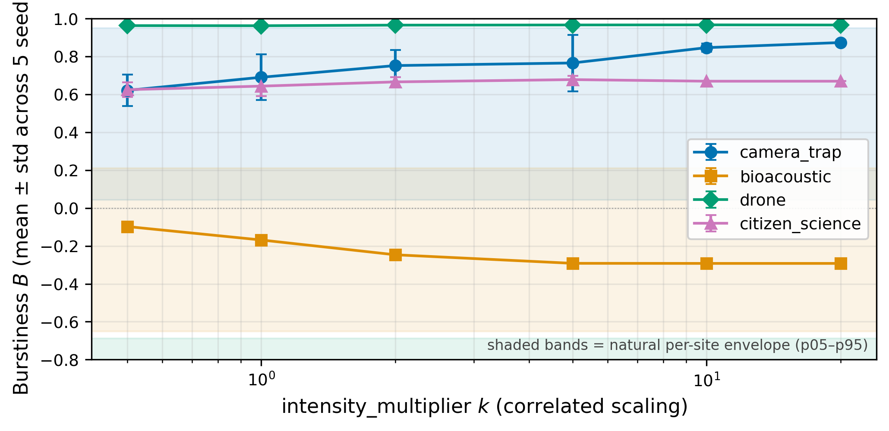

# Supplementary Material

**A Blueprint for Cross-Modal Coordination at the Far Edge**

Tables and figures that appeared in the submitted version and were cut from the
camera-ready for space. Nothing here is new: every artifact is referenced from
the main text, and the numbers reproduce those reported in the paper. Section
numbers below (§V-D.2, §VI-A.1, …) refer to the **main paper**, not to this
document.

The LaTeX sources for these tables are alongside this file in
[`figures/`](figures/), and the figures are regenerated by
[`../scripts/figures/`](../scripts/figures/).

---

## 1. Notation (§III)

### Modalities and traces

| Symbol | Meaning |
|---|---|
| $M$ | Set of recorded modalities |
| $T_m$ | Normalized per-modality trace, modality $m \in M$ |
| $\tau_m$ | Observation horizon of trace $T_m$ |

### Arrival behavior

| Symbol | Meaning |
|---|---|
| $\lbrace t_i \rbrace$ | Change points partitioning $\tau_m$ |
| $R_{m,i}$ | Arrival rate of modality $m$ in segment $i$ |
| $\rho_m$ | Arrival process $\lbrace (t_i, R_{m,i}) \rbrace_i$ for modality $m$ |
| $\mathrm{CV}_m$ | Coefficient of variation of $m$'s inter-arrival times |
| $B_m$ | Burstiness, $(\mathrm{CV}_m - 1)/(\mathrm{CV}_m + 1) \in [-1, 1]$ |

### Cross-modal and post-filter

| Symbol | Meaning |
|---|---|
| $C_{m,m'}$ | Cross-modal co-occurrence (Jaccard) $\in [0, 1]$ |
| $\phi_m^{\mathrm{raw}}$ | Raw arrival rate of modality $m$ |
| $\phi_m^{\mathrm{det}}$ | Post-detection rate of modality $m$ |
| $\phi_m^{\mathrm{thr}}$ | Post-threshold rate of modality $m$ |
| $\phi_m$ | Throughput tuple $(\phi_m^{\mathrm{raw}}, \phi_m^{\mathrm{det}}, \phi_m^{\mathrm{thr}})$ |

### Workload model and synthesis

| Symbol | Meaning |
|---|---|
| $\mathcal{W}$ | Workload model $\lbrace \rho_m, B_m, C_{m,m'}, \phi_m \rbrace_{m \in M}$ |
| $c$ | Configuration |
| $c_{\mathrm{id}}$ | Identity recipe (baseline from real traces) |
| $s$ | Random seed |
| $T^*$ | Synthetic multimodal trace, $T^* = \mathrm{synth}(\mathcal{W}, c, s)$ |

### Fidelity statistics

| Symbol | Meaning |
|---|---|
| $\mathrm{KS}_{\mathrm{diurnal}}$ | KS distance between hour-of-day arrival distributions |
| $\mathrm{spread}_s[\cdot]$ | Bootstrap 95% interval across seeds |
| $\mathrm{spread}_{\mathrm{site}}[\cdot]$ | Bootstrap 95% interval across recorded sites |

---

## 2. Synthesis fidelity scorecard (§VI-A)

All three fidelity criteria pass on the recorded traces; the derived
generalization test recovers prior work's directional shifts qualitatively.
These establish that synthesis is self-consistent with the recorded traces —
they are **not** a validation against a deployed cross-modal system.

| Criterion | What it licenses | Result |
|---|---|---|
| **Identity test** | Re-emission of recorded distribution | **PASS** — $\Delta B_m \leq 0.10$ all modalities; max $= 0.092$ (bioacoustic) |
| **Variance bound** | Distributional plausibility for synthesis recipes | **PASS** — $n_{\mathrm{pass}} = 9/9$; $W_{m,\theta} \in [0.002, 0.48]$ |
| **Operational fidelity** | Provisioning policy comparison | **PASS** — laptop tier; Kendall $\tau = 1.00$ on policy SLO ranking |
| **Generalization** (derived) | What-if planning beyond recorded conditions | **PASS** — qualitative direction recovery; L2 sweep $n = 12/18$ cells in envelope |

The bioacoustic identity deviation ($\Delta B = 0.092$) reflects two
recording-schedule regimes — hourly-clocked and chorus-only ARUs — being mixed
in the modality-level synthesis bootstrap.

---

## 3. Operational fidelity detail (§VI-A.2)

Per-policy detail behind the operational-fidelity check, on the laptop tier.

| Policy | Recorded $p_{95}$ (ms) | Recorded SLO (%) | Recorded energy (kJ) | Synth $p_{95}$ (ms) | Synth SLO (%) | Synth energy (kJ) |
|---|---:|---:|---:|---:|---:|---:|
| process-all | 100 | 100 | 95.4 | 100 | 100 | 453.7 |
| event-triggered | 100 | 100 | 9.9 | 100 | 100 | 38.0 |
| adaptive | 200 | 100 | 11.9 | 200 | 100 | 12.0 |
| control-theoretic | 200 | 100 | 9.9 | 200 | 100 | 38.0 |

Recorded strict camera trace ($n = 39{,}742$ events) vs. identity-synthesized
camera-only trace ($n \approx 189{,}000$ events, mean over 3 seeds). Per-policy
$p_{95}$ latency and SLO compliance match exactly; total energy scales with
event count while per-event energy is exactly invariant (2.40 J/event in all
eight cells). Policy ranking by $p_{95}$ latency is preserved (Kendall
$\tau = 1.0$).

> **Reading note.** The recorded and synthesized arms are drawn from different
> site populations — the recorded strict trace covers 3 camera sites, the
> synthesized trace 5 — which is why total energy differs by ~4.76×, matching
> the event-count ratio. Note also that SLO compliance is 100% in every cell and
> $p_{95}$ takes only two distinct values, so those two columns have no variance
> to rank; the columns that separate the two arms are coverage and energy. See
> [`../REPRODUCIBILITY.md`](../REPRODUCIBILITY.md).

---

## 4. Per-policy coverage–energy tradeoff (§IV-C)

The operating points the four inference policies admit, on the recorded camera
trace at the field-laptop tier.

Regenerate: `python3 ../scripts/figures/fig_08_pareto_policies.py`

---

## 5. Variance envelope (§VI-A.1)

Variance envelope across modality × statistic bins. All 9 cells satisfy
$\mathrm{spread}_s[\theta(T^*)] \leq \mathrm{spread}_{\mathrm{site}}[\theta(T_m)]$.

Regenerate: `python3 ../scripts/figures/fig_app_03_variance_envelope.py`

---

## 6. Case-study takeaways (§VI-B)

Configurations, feasibility verdicts, and provisioning takeaways for CS1–CS4.

### CS1 — Bioacoustic → camera trap

**Configuration.** Conditional scaling (assumed 2× for 60 s post-trigger); 2 s SLO.

**Feasibility.** RTX and Jetson feasible. Laptop infeasible (CPU latency).
Pi5+TPU structurally unsupported — no Edge TPU path for MegaDetector. Pi4
infeasible (CPU latency).

**Provisioning takeaway.** Jetson is the minimum tier under a 2 s SLO regardless
of bioacoustic schedule. Schedule choice (hourly vs. chorus) is a
workload-design lever that shapes response-tier sizing.

### CS2 — Camera trap → drone

**Configuration.** Interleave with response delay $\sim \mathcal{U}[0.1, 5.0]$ s; 5 s SLO.

**Feasibility.** RTX, Jetson, Pi5+TPU and Pi4 all feasible. Laptop infeasible;
verdict confirmed empirically (+23.4% measured-vs-predicted gap).

**Provisioning takeaway.** Pi-class hardware is predicted feasible at this SLO;
drone-side inference is not the binding constraint. The field laptop is the
limiting tier — not a more capable alternative.

### CS3 — Focal camera trap → camera-trap network

**Configuration.** Conditional scaling (assumed 1.5× neighbor density for 10 s); 10 s SLO.

**Feasibility.** RTX, Jetson, Pi5+TPU and Pi4 all feasible. Laptop infeasible
(latency overrun + queue overflow).

**Provisioning takeaway.** Gateway-tier capacity must be sized against the
two-site worst case, not an asymptotic full-network average — camera-trap sites
share diurnal structure.

### CS4 — Citizen science → all

**Configuration.** Prior injection (assumed 1.25× density boost during 60 s
post-citsci windows); 60 s SLO.

**Feasibility.** Feasible on all five tiers. Laptop reaches 43.6% MegaDetector
utilization under the adaptive policy.

**Provisioning takeaway.** Citsci-as-prior does not stress edge-tier compute at
the densities evaluated. Size the gateway-tier ingestion pipeline against the
citsci arrival rate, scaled by the prior's spatial granularity.

> **Note on case-study labels.** Internal harness labels for CS1 and CS2 are
> inverted relative to the manuscript; the remap is handled in
> `build_master_feasibility.py`, and `master_feasibility.csv` retains both
> `case_study` and `case_study_internal` columns. Published SLOs are CS1 2 s,
> CS2 5 s, CS3 10 s, CS4 60 s.

---

## 7. Intensity sweep (§V-D.2)

Synthesis under intensity scaling $r_k$ for $k \in \lbrace 0.5, 1, 2, 5, 10, 20 \rbrace$,
compared against natural per-site bounds (shaded).

This is a **burstiness** sweep — $B$ against $k$ — not a feasibility sweep. The
feasibility grid is computed at 1× only, so the sweep carries no per-case
verdicts. See [`../REPRODUCIBILITY.md`](../REPRODUCIBILITY.md).

Regenerate: `python3 ../scripts/figures/fig_app_04_intensity_sweep.py`

---

Analysis code and the derived per-modality event tables from which these
artifacts are generated are in [the repository root](../).
