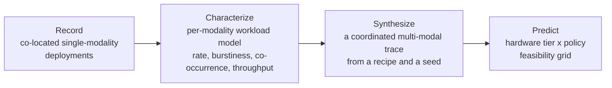

# Cross-modal coordination: planning a sensing system from its metadata

Distributed sensing systems are expensive to deploy. A camera-trap network, a
set of acoustic recorders, drone flights, and visitor photographs each cost
field time, hardware, and compute, and once deployed they are hard to change.
Yet the planning tools that other infrastructure takes for granted, the ones
that tell you which hardware tier, which sensor configuration, which model, and
which filtering threshold a deployment needs *before* you build it, do not
exist for ecological sensing. Systems get sized by rule of thumb and
corrected in the field.

The metadata in this release is what makes such tools possible. Fine-grained
timestamps, sensor configurations, and confidence-scored detections, aligned
across modalities, are enough to characterize each modality's workload, to
synthesize the workload a coordinated multi-modal system *would* produce, and
to predict whether a given hardware tier can keep up. The paper *A Blueprint
for Cross-Modal Coordination at the Far Edge* (Kline, Potlapally, Cheng,
Berger-Wolf, Subramoni, Stewart; to appear) develops that method on the
SmartWilds metadata, and `analysis/cross_modal_coordination/` is its code and
derived data, included here as a worked example of what the metadata enables.

## The method: record, characterize, synthesize



| Phase | What it produces | Where |
|---|---|---|
| Characterize | Workload model per modality: change-point arrival rates, burstiness, diurnal profile, cross-modal co-occurrence | `scripts/01_characterize/`, shipped as `data/primitives/` |
| Synthesize | A synthetic multi-modal trace from a *recipe*: which modalities, how one modality's detections re-shape another's sampling (interleave, conditional scaling, prior injection), at what intensity | `scripts/02_synthesize/` |
| Case studies | Four coordination scenarios: acoustic detection triggers cameras; a camera triggers a drone; a focal camera re-tunes its neighbors; citizen-science reports act as priors for everything | `scripts/03_case_studies/` |
| Fidelity | Does synthesis stay within the natural variation of the recorded sites? Identity test, variance envelope, topology scaling, intensity sweep | `scripts/04_fidelity/` |
| Feasibility | Predicted hardware tier × inference policy grid for each case study, calibrated against one measured cell | `scripts/05_feasibility/` |
| Figures and supplement | The paper's figures and the tables cut from it | `scripts/figures/`, `supplement/` |

Synthesis is deterministic: the same recipe and seed always produce the same
trace. The identity recipe re-emits the recorded event counts within 0.1 to
4.3 percent for every modality.

## What it says about the metadata

- **Burstiness is a joint property of modality and deployment topology.**
  Camera-trap and drone arrivals have burstiness above 0.5, so provisioning
  must be for peak rate, not mean rate, and adding sites changes burstiness in
  a modality-specific way. None of this is visible without second-level,
  corrected timestamps.
- **Cross-modal co-occurrence is low at the hour scale** (all pairwise Jaccard
  below 0.05), which licenses treating modalities as independent in synthesis
  and is itself a finding about how these sensors sample the landscape.
- **Feasibility verdicts depend on sensor configuration.** The acoustic
  recorder's schedule (hourly versus dawn-and-dusk chorus) changes the response
  tier a camera network needs; the camera's photo-versus-video mode changes
  the detection pipeline's load. The sensor configurations in
  `metadata/sensor_configurations.md` are inputs to the model, not footnotes.
- **A field laptop is the limiting tier under tight latency targets**, and the
  one measured cell confirmed the prediction within 23 percent.

## Running it

```bash
cd analysis/cross_modal_coordination
pip install -r requirements.txt
./run_all.sh                          # identity synthesis, four case studies, fidelity checks
for f in scripts/figures/fig_*.py; do python3 "$f"; done   # the paper's figures
```

No archive access is needed: the shipped workload primitives are enough to
synthesize all four modalities. Read `REPRODUCIBILITY.md` first; it lists
what reproduces exactly, what needs the field archive, and which published
numbers carry caveats. `supplement/README.md` holds the tables and figures
cut from the camera-ready.

## Relation to the rest of the release

The arrival statistics that feed this analysis are the same ones shipped with
the study-level dataset (`analysis/arrival_traces_v2/`, see
[Arrival traces](../scripts/arrival-traces.md)), and the workload primitives
derive from the Darwin Core Occurrence tables documented
[here](../datasets/darwin-core-tables.md). The point of keeping that metadata
clean and aligned is precisely that analyses like this one become possible.
