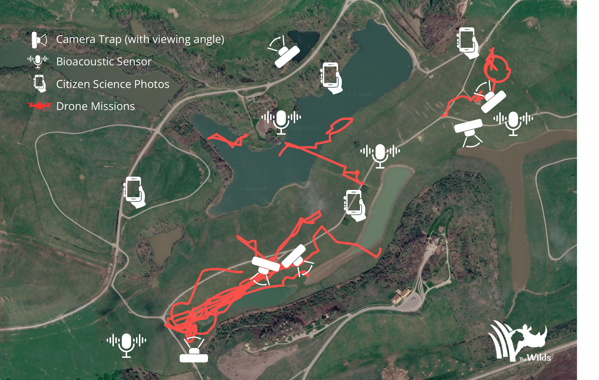
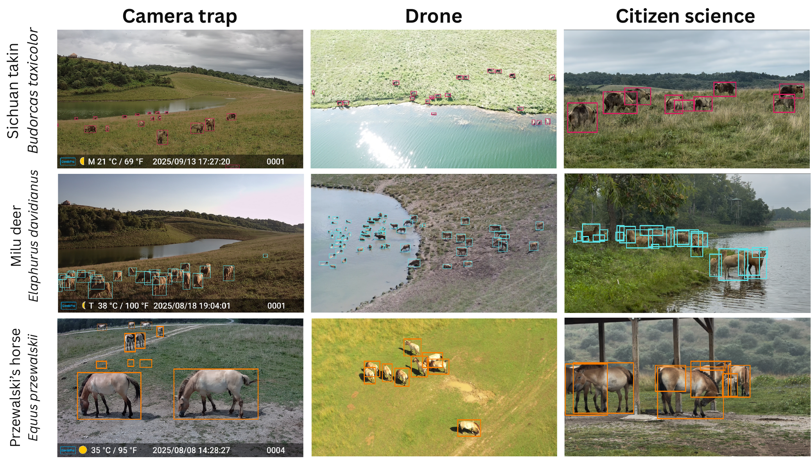

# SmartWilds

**Integration, alignment, and release code for a multi-modal field sensing dataset**

SmartWilds is a multi-modal sensing dataset recorded with camera traps, acoustic
recorders, drones, and visitor photographs at [The Wilds](https://thewilds.columbuszoo.org/)
(Cumberland, Ohio) in summer 2025. This repository is about the **metadata**:
how four independently collected sensor streams were integrated into one
Darwin Core release, how their clocks and coordinates were repaired so they can
be [joined in space and time](datasets/joining.md), what was found wrong with the
data and how it was fixed, and how LLM coding agents did much of that
documentation work.

It is deliberately not about the raw images and recordings, and not about
labeling them. The raw files will be released in the future; the people who
work with such data know how to label them. What is usually missing, and what this release provides, is the
cleaned, documented metadata layer that lets the modalities be analyzed
together.



**Figure 1.** Sensor deployment across The Wilds: camera traps with viewing
angles, Song Meter recorders, citizen-science photo locations, and drone flight
tracks. Satellite imagery © Google.



**Figure 2.** The same three managed focal species (Sichuan takin, Milu deer,
Przewalski's horse) observed by camera trap, drone, and citizen-science
photography.

## What is released

The Darwin Core Event and Occurrence tables, the dataset cards, the
supplemental material and defect inventory, the field notes and campaign
reports, and the code that produced and validated all of it. The raw media
(images, audio, video) will be released in the future. The 2025 pilot media are
already in the [SmartWilds collection](https://huggingface.co/collections/imageomics/smartwilds).

| Part | Where |
|---|---|
| How to join the modalities | [Joining in space and time](datasets/joining.md) |
| Darwin Core tables (current build) | [`darwin_core/`](datasets/darwin-core-tables.md) |
| Dataset cards for the five SmartWilds datasets | [`metadata/`](datasets/dataset-cards.md) |
| Supplemental material, defect inventory, camera-trap release note | [`docs/`](SUPPLEMENTAL.md) |
| Field notes, data summaries, campaign data reports | [`field_campaigns/`](datasets/field-campaigns.md) |
| Generation, validation, georeferencing, screening scripts | [`scripts/`](scripts/index.md) |
| What the metadata enables: cross-modal coordination planning | [`analysis/`](analysis/cross-modal-coordination.md) |
| How the agents were used, and how to use them on your data | [Agents](agents/index.md) |

## Getting started

```bash
git clone https://github.com/Imageomics/smartwilds
cd smartwilds
pip install -r requirements.txt
python examples/quickstart.py darwin_core/smartwilds-camera-traps darwin_core/smartwilds-bioacoustics
```

The quickstart loads the tables, applies a verification floor, joins
Occurrences to their Events, and summarizes them by deployment and by class.
See [Using the data correctly](datasets/overview.md#using-the-data-correctly)
before computing anything from the Occurrence tables.

## Papers

- *SmartWilds: Integrating, Aligning, and Documenting Multi-Modal Field Sensing
  Data* (under review). The supplemental material is [here](SUPPLEMENTAL.md).
- [SmartWilds: Multimodal Wildlife Monitoring Dataset](https://arxiv.org/abs/2509.18894),
  the 2025 four-day pilot release.
- [A Blueprint for Cross-Modal Coordination at the Far Edge](analysis/cross-modal-coordination.md)
  (to appear; code and derived data in `analysis/cross_modal_coordination/`) and [Cross-Modal Corroboration for Annotation-Free Wildlife
  Monitoring](https://arxiv.org/abs/2606.21613) build on the deployment.

## Citation

See [`CITATION.cff`](https://github.com/Imageomics/smartwilds/blob/main/CITATION.cff).
Please cite the paper and each dataset you use.
