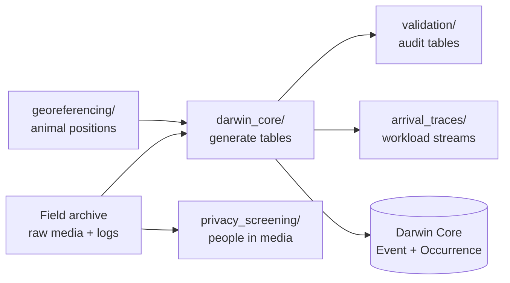

# Scripts

The code that turns the SmartWilds field archive into the released Darwin Core
tables, and the checks that were run on them. The scripts are grouped by stage:



| Directory | Stage | Page |
|---|---|---|
| `scripts/darwin_core/` | Build the Event and Occurrence tables for every modality and merge them; reconcile raw WAV files against the acoustic Events | [Darwin Core generation](darwin-core.md) |
| `scripts/validation/` | Read-only integrity audit of a generated table set | [Validation](validation.md) |
| `scripts/arrival_traces/` | Campaign-2 arrival streams for the systems analysis | [Arrival traces](arrival-traces.md) |
| `scripts/georeferencing/` | Project camera-trap and drone detection boxes to ground coordinates | [Georeferencing](georeferencing.md) |
| `scripts/privacy_screening/` | Find people in the media, triage by identifiability, plan drone trims | [Privacy screening](privacy-screening.md) |
| `examples/quickstart.py` | Load and summarize the released tables | [Example](examples.md) |

## Environment variables

Every script reads its input locations from environment variables, so nothing
depends on the layout of the machine the pipeline originally ran on. Set the
ones you need before running a script.

| Variable | Used by | Meaning |
|---|---|---|
| `SMARTWILDS_ARCHIVE` | all | Root of the field archive: the `thewilds_<campaign>/` directories and `processing_output/`. Default: current directory |
| `SMARTWILDS_DWC_OUT` | `darwin_core/` | Where the generated Darwin Core tables are written. Default: `<archive>/processing_output/darwin_core_release` |
| `SMARTWILDS_DETECTIONS` | `darwin_core/generate_darwin_core.py` | External SAM3 + BioCLIP detection workspace (per-video prediction CSVs) |
| `SMARTWILDS_RELEASE` | `privacy_screening/trim_drones.py` | Root of the staged per-modality datasets |
| `SMARTWILDS_SCRUBBED_MEDIA` | `privacy_screening/trim_drones.py` | Output directory for trimmed drone videos |
| `MEGADETECTOR_WEIGHTS` | `privacy_screening/screen_videos.py` | Path to `md_v5a.0.0.pt` |
| `CAMERA_TRAP_GEOLOCATION_SRC` | `georeferencing/geolocate_camera_trap_treeoflife_predictions.py` | `src/` directory of a checkout of Imageomics/camera-trap-geolocation |

## Installation

```bash
pip install -r requirements.txt
```

The core scripts (`darwin_core/`, `validation/`, `arrival_traces/`) use only
the Python standard library. `pandas`, `numpy`, `pillow`, and
`opencv-python-headless` are needed for the example and for privacy screening;
MegaDetector, `av`, and `imageio-ffmpeg` only for screening (see the commented
block in `requirements.txt`).

## Archive layout the scripts expect

```
<archive>/
├── thewilds_20250630_20250703/        # campaign 1
│   ├── camera_traps/<site>-<camera>/<SD card>/...
│   ├── bioacoustics/<site>-<recorder>/...
│   └── drones/<flight>/{metadata,videos}/
├── thewilds_20250804_20250828/        # campaign 2 (+ citizen_science/)
├── thewilds_20250908_20250908/        # campaign 3
└── processing_output/
    ├── detections/                    # detector outputs, timestamp map, geolocation
    └── darwin_core_release/           # SMARTWILDS_DWC_OUT
```

Packaging the tables into the per-modality Hugging Face datasets and rendering
the dataset cards happens in the project's internal release staging and is not
part of this repository.
