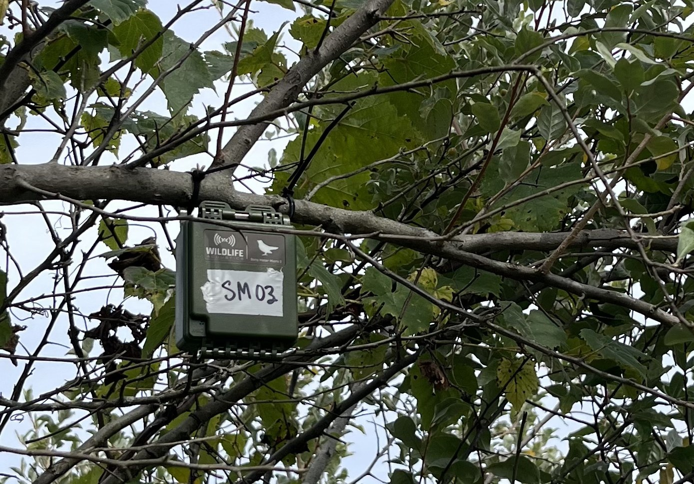

# Dataset Card for SmartWilds Bioacoustics



*A Wildlife Acoustics Song Meter Micro 2 (SM03) deployed in a tree at The Wilds.*

**Every retained acoustic recording from 10 recorder deployments at The Wilds in
summer 2025, the schedule each recorder actually ran, and the birds BirdNET
heard in each file.**

This is the bioacoustics dataset of the **SmartWilds** collection. Each modality
has its own dataset and DOI. They share one Darwin Core Event hierarchy rooted
at `TheWilds_2025` and are joined by the
[SmartWilds collection](https://huggingface.co/collections/imageomics/smartwilds).

## Dataset Details

- **Curated by:** Jenna M. Kline, Anirudh Potlapally, Elizabeth G. Campolongo
- **Homepage:** <https://github.com/Imageomics/smartwilds> (documentation: <https://imageomics.github.io/smartwilds/>)
- **Paper:** SmartWilds: Integrating, Aligning, and Documenting Multi-Modal Field Sensing Data (under review)
- **Release build:** 2026-10-22

| Campaign | Dates | Deployments | WAV released |
|---|---|---:|---:|
| 1 | 2025-06-30 to 2025-07-03 | 4 | 311 |
| 2 | 2025-08-04 to 2025-08-28 | 6 | 2,060 |

**Darwin Core tables.** The Event table has 2,382 rows: 1 `Project`, 10
`SensorDeployment`, and 2,371 `AudioRecording` Events, one per WAV file with its
start time. There are 9,960 Occurrences. Each Occurrence is one
**recording × species** pair, and `individualCount` gives the number of 3-second
BirdNET detections of that species in the file (93,509 in total).

### Supported Tasks

- **Bird audio classification and re-labeling:** the raw WAV files plus the
  BirdNET settings let you rerun BirdNET or swap in another classifier.
- **Duty-cycle and acquisition-workload studies:** each recorder ran a different
  schedule (5 min/h, 15 min/h, sunrise-sunset continuous, 1 h at dawn and
  dusk), so `metadata/deployments.csv` supports counterfactual sampling-effort
  analyses.
- **Cross-modal comparison:** recorders sit beside the camera traps at
  TW02, TW06, and TW09.

## Dataset Structure

```
smartwilds-bioacoustics/
├── data/
│   ├── events.csv          # Project, SensorDeployment, AudioRecording Events
│   ├── occurrences.csv     # one row per recording x species
│   └── recordings.csv      # one row per WAV path on disk (2,453): disposition
├── media/                  # media/<campaign>/<deployment>/<sd-card>/*.wav
├── media_manifest.csv
├── metadata/
│   ├── deployments.csv     # recorder, site, GPS, schedule, WAV counts
│   ├── birdnet_settings.csv
│   └── provenance/         # raw-WAV reconciliation report, repair audit
└── scripts/
```

`associatedMedia` on each `AudioRecording` Event and on each Occurrence gives
the release-relative path of the WAV file.

### Sensor settings

All recorders are Wildlife Acoustics **Song Meter Micro 2**, 48 kHz.
`metadata/deployments.csv` records the schedule each recorder actually ran.
TW05-SM01 in Campaign 1 was configured for 1 h at sunrise and sunset but
recorded 5-minute clips every hour. The release documents the actual schedule
and notes the intended one.

| Schedule | Duty cycle | Recorders |
|---|---|---|
| 5 min every hour | 8.3% | TW05-SM01, TW06-SM03, TW08-SM04 (C1); TW02-SM04 (C2) |
| 15 min every hour | 25% | TW06-SM05 (C2) |
| Sunrise to sunset, continuous | ~50-60% | TW05-SM06, TW07-SM02, TW08-SM03, TW09-SM01 (C2) |
| 1 h at sunrise and sunset | ~8% | TW07-SM02 (C1) |

### Annotation method

- **Method:** automated. No human verification (all rows are `unverified`).
- **Classifier:** BirdNET Analyzer v2.4, with 3.0 s segments, a 48 kHz sample
  rate, and a 0-15 kHz bandpass.
- **Taxon fields:** filled from BirdNET common-name mappings.
- **Coordinates:** the recorder location, not the animal location.

## Dataset Creation

### Raw-WAV reconciliation

There are 2,453 WAV paths on disk. `data/recordings.csv` classifies every one:

| Disposition | Files |
|---|---:|
| Released, with detections | 2,307 |
| Released, BirdNET ran but detected nothing (Event, no Occurrence) | 64 |
| Excluded: Campaign-1 files copied into a Campaign-2 directory (transfer duplicates) | 78 |
| Excluded: no BirdNET result, either truncated (3.9-22 s) or unreadable | 4 |

The zero-detection recordings are kept as Events. This lets a user tell
"recorded, nothing heard" apart from "not recorded".

## Considerations for Using the Data

- **`individualCount` counts detections, not birds.** A singing bird produces
  many 3-second detections.
- **No confidence threshold is recorded per Occurrence.** Re-run BirdNET from the
  WAV files if you need score-level control.
- **Acquisition is driven by the schedule.** Arrival burstiness is low
  (B ≈ +0.10). Detection burstiness is high (B ≈ +0.53) and concentrated in the
  dawn chorus.

## Supplemental Material

Extended inventories, the timestamp-repair methods, the standards crosswalk,
validation checks, and the full defect inventory are in
[`SUPPLEMENTAL.md`](https://huggingface.co/datasets/imageomics/smartwilds/blob/main/SUPPLEMENTAL.md)
in the study-level SmartWilds dataset.

## Licensing

Data: [CC0 1.0](https://creativecommons.org/publicdomain/zero/1.0/). Scripts: MIT.

## Citation

```bibtex
@misc{smartwilds2025_bioacoustics,
  author    = {Kline, Jenna M. and Potlapally, Anirudh and Campolongo, Elizabeth G.},
  title     = {SmartWilds Bioacoustics (The Wilds 2025)},
  year      = {2026},
  publisher = {Hugging Face},
  note      = {DOI pending the raw data release},
  url       = {https://huggingface.co/datasets/imageomics/smartwilds-bioacoustics}
}
```

Please also cite the paper:

```bibtex
@article{kline2026smartwilds,
  author  = {Kline, Jenna M. and Potlapally, Anirudh and Campolongo, Elizabeth G.},
  title   = {SmartWilds: Integrating, Aligning, and Documenting Multi-Modal Field Sensing Data},
  year    = {2026},
  note    = {Under review}
}
```

This dataset card follows the [FAIR² Drones Data Standard](https://imageomics.github.io/fair_drones/)
(Kline and Campolongo, 2026).

## Acknowledgements

This project is supported by the [Imageomics Institute](https://imageomics.org), which is funded by the US National Science Foundation's Harnessing the Data Revolution (HDR) program under [Award #2118240](https://www.nsf.gov/awardsearch/showAward?AWD_ID=2118240) (Imageomics: A New Frontier of Biological Information Powered by Knowledge-Guided Machine Learning), and by the [AI Institute for Intelligent Cyberinfrastructure with Computational Learning in the Environment (ICICLE)](https://icicle.osu.edu/), which is funded by the US National Science Foundation under [Award #2112606](https://www.nsf.gov/awardsearch/showAward?AWD_ID=2112606).

This work is also supported by the AI and Biodiversity Change (ABC) Global Center. The ABC Global Center is funded by the US National Science Foundation under [Award No. 2330423](https://www.nsf.gov/awardsearch/showAward?AWD_ID=2330423&HistoricalAwards=false) and the Natural Sciences and Engineering Research Council of Canada under [Award No. 585136](https://www.nserc-crsng.gc.ca/ase-oro/Details-Detailles_eng.asp?id=782440). This dataset draws on research supported by the Social Sciences and Humanities Research Council.

Any opinions, findings and conclusions or recommendations expressed in this material are those of the author(s) and do not necessarily reflect the views of the National Science Foundation, Natural Sciences and Engineering Research Council of Canada, or Social Sciences and Humanities Research Council.

Special thanks to Dan Beetem and [The Wilds](https://www.thewilds.org/) in Ohio for providing access to deployment sites and supporting this wildlife monitoring research. We thank the Columbus Zoo and Aquarium for their support in facilitating this project. All data collection, including drone flights, was conducted under the supervision of the Director of Animal Management, with permission from The Wilds Animal Care and Use Committee.

This work used the [Ohio Supercomputer Center](https://www.osc.edu/) (Ohio Supercomputer Center. 1987. Ohio Supercomputer Center. Columbus OH: Ohio Supercomputer Center. <https://ror.org/01apna436>).

## Dataset Card Contact

Jenna M. Kline (kline.377@osu.edu)
