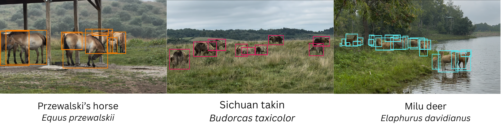

# Dataset Card for SmartWilds Citizen Science


*Visitor photographs of Przewalski's horse, Sichuan takin, and Milu (Père David's) deer, with annotation boxes.*


This is the citizen-science dataset of the **SmartWilds** collection. Each
modality has its own dataset and DOI. They share one Darwin Core Event hierarchy
rooted at `TheWilds_2025` and are joined by the SmartWilds collection.

## Dataset Details

- **Curated by:** Jenna M. Kline, Anirudh Potlapally, Elizabeth G. Campolongo
- **Homepage:** <https://github.com/Imageomics/smartwilds> (documentation: <https://imageomics.github.io/smartwilds/>)
- **Paper:** SmartWilds: Integrating, Aligning, and Documenting Multi-Modal Field Sensing Data (under review)
- **Release build:** 2026-10-22

Members of the project team, moving through the park as visitors do,
submitted photographs through a structured web form; the team holds the
rights to the media. The release distinguishes four counts, each a different
unit:

| Unit | Count |
|---|---:|
| Raw media files in `photos_videos` (965 images, 138 videos) | 1,103 |
| Photos manually annotated | 791 |
| Curated wildlife photos | 564 |
| Darwin Core Occurrences (some photos contain several taxa) | 622 |

Fifty of the curated photos, all from September 8, came from a Google Photos
album export that is not part of the project archive. Their 50 Occurrences are
released, but the photos are not: `associatedMedia` is blank for these rows,
and `occurrenceRemarks` gives the original album path and the reason
(`media_not_distributed`).

The Event table has 14 rows: 1 `Project` and 13 `ObservationSession`.

### Annotation method

- **Method:** manual. All 622 Occurrences are `verified by expert`
  (`HumanObservation`).
- **Locality:** coordinates are generalized to locality level.

### Personal and sensitive information

The photographs were taken by project researchers, not by members of the
public, so no third-party consent is needed for their release. Some show
other visitors. Media in which a person can be individually identified are removed from the
release. People too small to identify (a person box under 80 px in the native
image, where the face is under about 10 px) are retained; every file with a
larger person detection was reviewed by a person before release.

## Considerations for Using the Data

- **Submissions arrive only during operating hours.** The diurnal profile is
  truncated by visitor schedules, not by animal activity.
- **Visitors' attention skews the taxa.** Charismatic and easily seen taxa are
  over-represented.

## Supplemental Material

Extended inventories, the timestamp-repair methods, the standards crosswalk,
validation checks, and the full defect inventory are in
[`SUPPLEMENTAL.md`](https://huggingface.co/datasets/imageomics/smartwilds/blob/main/SUPPLEMENTAL.md)
in the study-level SmartWilds dataset.

## Licensing

Data: [CC0 1.0](https://creativecommons.org/publicdomain/zero/1.0/). Scripts: MIT.

## Citation

```bibtex
@misc{smartwilds2025_citizen_science,
  author    = {Kline, Jenna M. and Potlapally, Anirudh and Campolongo, Elizabeth G.},
  title     = {SmartWilds Citizen Science (The Wilds 2025)},
  year      = {2026},
  publisher = {Hugging Face},
  note      = {DOI pending the raw data release},
  url       = {https://huggingface.co/datasets/imageomics/smartwilds-citizen-science}
}
```

Please also cite the paper:

```bibtex
@article{kline2026smartwilds,
  author  = {Kline, Jenna M. and Potlapally, Anirudh and Campolongo, Elizabeth G.},
  title   = {SmartWilds: Integrating, Aligning, and Documenting Multi-Modal Field Sensing Data},
  year    = {2026},
  note    = {Under review}
}
```

This dataset card follows the [FAIR² Drones Data Standard](https://imageomics.github.io/fair_drones/)
(Kline and Campolongo, 2026).

## Acknowledgements

This project is supported by the [Imageomics Institute](https://imageomics.org), which is funded by the US National Science Foundation's Harnessing the Data Revolution (HDR) program under [Award #2118240](https://www.nsf.gov/awardsearch/showAward?AWD_ID=2118240) (Imageomics: A New Frontier of Biological Information Powered by Knowledge-Guided Machine Learning), and by the [AI Institute for Intelligent Cyberinfrastructure with Computational Learning in the Environment (ICICLE)](https://icicle.osu.edu/), which is funded by the US National Science Foundation under [Award #2112606](https://www.nsf.gov/awardsearch/showAward?AWD_ID=2112606).

This work is also supported by the AI and Biodiversity Change (ABC) Global Center. The ABC Global Center is funded by the US National Science Foundation under [Award No. 2330423](https://www.nsf.gov/awardsearch/showAward?AWD_ID=2330423&HistoricalAwards=false) and the Natural Sciences and Engineering Research Council of Canada under [Award No. 585136](https://www.nserc-crsng.gc.ca/ase-oro/Details-Detailles_eng.asp?id=782440). This dataset draws on research supported by the Social Sciences and Humanities Research Council.

Any opinions, findings and conclusions or recommendations expressed in this material are those of the author(s) and do not necessarily reflect the views of the National Science Foundation, Natural Sciences and Engineering Research Council of Canada, or Social Sciences and Humanities Research Council.

Special thanks to Dan Beetem and [The Wilds](https://www.thewilds.org/) in Ohio for providing access to deployment sites and supporting this wildlife monitoring research. We thank the Columbus Zoo and Aquarium for their support in facilitating this project. All data collection, including drone flights, was conducted under the supervision of the Director of Animal Management, with permission from The Wilds Animal Care and Use Committee.

This work used the [Ohio Supercomputer Center](https://www.osc.edu/) (Ohio Supercomputer Center, 1987, <http://osc.edu/ark:/19495/f5s1ph73>).

## Dataset Card Contact

Jenna M. Kline (kline.377@osu.edu)
