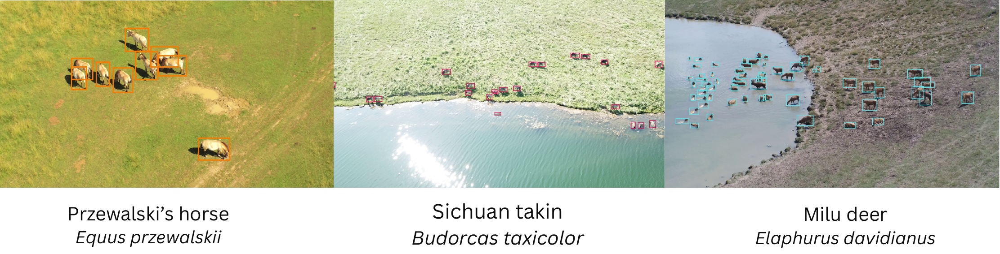

# Dataset Card for SmartWilds Drones


*SAM3 detections on drone frames of Przewalski's horse, Sichuan takin, and Milu (Père David's) deer.*

**Every drone video flown at The Wilds in 2025, with each platform's raw
telemetry, and frame-level animal detections placed on the ground where the
telemetry allows it.**

This is the drone dataset of the **SmartWilds** collection. Each modality has
its own dataset and DOI. They share one Darwin Core Event hierarchy rooted at
`TheWilds_2025` and are joined by the
[SmartWilds collection](https://huggingface.co/collections/imageomics/smartwilds).

## Dataset Details

- **Curated by:** Jenna M. Kline, Anirudh Potlapally, Elizabeth G. Campolongo
- **Homepage:** <https://github.com/Imageomics/smartwilds> (documentation: <https://imageomics.github.io/smartwilds/>)
- **Paper:** SmartWilds: Integrating, Aligning, and Documenting Multi-Modal Field Sensing Data (under review)
- **Release build:** 2026-10-22

| Campaign | Dates | Sessions | Platform |
|---|---|---:|---|
| 1 | Jul 1, Jul 3 | 6 | Parrot Anafi 4K |
| 2 | Aug 11, 18, 25 | 4 + 1 | Parrot Anafi 4K; DJI (Aug 11) |
| 3 | Sep 8 | 4 | DJI Air 2 |

**Darwin Core tables.** The Event table has 55 rows: 1 `Project`, 15
`SensorDeployment` flight sessions, and 39 `MediaEvent` videos. There are
318,215 Occurrences: 318,203 machine detection crops on sampled frames and
12 human-added European starling boxes (`human-supported; limited-resolution`).
`metadata/flights.csv` summarizes each session with its platform, number of
videos, and number of Occurrences.

The 15 sessions are the 15 directories that contain video. Three more Aug 25
Parrot directories contain telemetry but no video. Their files are included in
`media/`, but they are not sampling Events.

### Supported Tasks

- **Aerial detection and classification:** you can re-label the raw video and
  compare against the released crops.
- **Telemetry-aware vision:** altitude, heading, and gimbal pitch are available
  per frame where the platform logged them.
- **Workload studies:** detection arrivals are extremely bursty (B ≈ +0.99), so
  they are a stress case for scheduling and offload.

## Dataset Structure

```
smartwilds-drones/
├── data/
│   ├── events.csv          # Project, 15 flight SensorDeployments, 39 MediaEvents
│   ├── occurrences.csv     # 318,215 frame-level detection crops
│   └── detections.csv      # per detection: video path, frame index, box (px)
├── media/                  # media/<campaign>/<flight>/... videos + telemetry
├── media_manifest.csv
├── metadata/
│   ├── flights.csv         # per-session platform, video and occurrence counts
│   ├── platforms.csv       # resolution, telemetry format per platform
│   ├── drone_projection_config.csv
│   └── provenance/         # date, coordinate, media and excluded-video audits
├── analysis/bird_water_association_per_box.csv
└── scripts/
```

### Raw video, not frames

The release ships the **raw videos**. It does not ship extracted frames. Each
machine detection in `data/detections.csv` gives the video (`video_path`), the
native frame number (`frame_index`), and the box in pixels. SAM3 ran on every
15th frame. Any frame can be regenerated:

```python
import cv2, pandas as pd
det = pd.read_csv("data/detections.csv")
row = det.iloc[0]
cap = cv2.VideoCapture(row.video_path)
cap.set(cv2.CAP_PROP_POS_FRAMES, int(row.frame_index))
ok, frame = cap.read()
x, y, w, h = map(int, (row.bbox_x, row.bbox_y, row.bbox_w, row.bbox_h))
crop = frame[max(y, 0):y + h, max(x, 0):x + w]
```

The 644 curated goose records come from a separate 20-frame review subset and
have no `frame_index`.

### Annotation method

- **Method:** automated, with a human-validated subset.
- **Detection:** SAM3 on frames extracted from each video.
- **Classification:** top-1 label from BioCLIP Tree-of-Life, written to the
  Darwin Core taxon fields. The rank, score, box, and altitude are in
  `identificationRemarks`.
- **Ground projection:** the ray through the bottom-center of the box is
  intersected with a flat ground plane, using drone GPS, AGL altitude,
  heading, gimbal pitch (with a fallback), and approximate FOV.
  `drone_georef_status` in `occurrenceRemarks` gives the result for each
  detection:

  | Status | Rows |
  |---|---:|
  | `ok` | 247,340 |
  | `invalid_altitude` | 27,306 |
  | `missing_drone_gps` | 24,467 |
  | `horizon_ray` | 18,324 |
  | `out_of_range` | 122 |

  When the status is not `ok`, the coordinate is the drone's own position, a
  validated static video-level location (500 m uncertainty), or blank.
  `dataGeneralizations` says which on every row. The flights were flown for
  population counts and behavior, not geolocation, so platform position
  places an animal in the right pasture.
- **Verification:** 317,559 rows are `unverified`. 644 are `validated` Canada
  goose records from a 20-frame review of `20250703_parrotanafi_5`.

## Dataset Creation

### Known defects and repairs

- **Aug 11 session has no time of day.** Its `eventDate` was exported as the
  string `nan` (41,524 Occurrences). The date was restored from the flight
  identifier. `eventTime` is blank because neither the telemetry nor the video
  containers keep a trustworthy capture time. Do not use these rows for
  intra-day or inter-arrival analyses.
- **Impossible coordinates on 7 Events** (`nan`, or longitude ≈ 500). These were
  replaced with a validated static video location, or left blank.
- **Frame media lost from scratch storage.** Extracted frames were deleted when
  the scratch workspace was purged. The affected Occurrences now point at the
  original video and are tagged
  `associated_media_source=original_video_fallback_missing_scratch_frame`.
  The release build on 2026-10-22 applied the same fallback to the last
  10,943 rows (479 frames). As a result, every drone `associatedMedia` value
  resolves to a released video.
- **One video was not processed.** `20250703_parrotanafi_4/VID_001` was reviewed
  and found to have no usable content. It is a `MediaEvent` with zero
  Occurrences.
- **Three telemetry schemas.** Field names, units (feet vs. meters), and gimbal
  conventions differ by platform and were mapped per platform.

### Personal and sensitive information

3,114 Occurrences are labeled *Homo sapiens*: field staff and visitors seen
from altitude. Media in which a person can be individually identified are removed from the
release. People too small to identify (a person box under 80 px in the native
image, where the face is under about 10 px) are retained; every file with a
larger person detection was reviewed by a person before release.
For drone videos this means trimming launch and landing segments where the
operators are identifiable; the trims are lossless and recorded in the
media manifest.

## Considerations for Using the Data

- **Detections count crops, not animals.** Adjacent frames repeat the same
  animal, so the counts measure evidence volume, not abundance.
- **Species-rank labels need curation.** The class-rank accuracy reported for
  the camera-trap subset (0.845) is the better guide to these labels.
  <!-- TODO(confirm-stats): the camera-trap card no longer reports this BioCLIP class accuracy (its labels are now triage-based). Keep the figure here only if the BioCLIP evaluation is reported elsewhere, e.g. SUPPLEMENTAL.md. -->

- **The DJI airframe for Aug 11 was not recorded.**

## Supplemental Material

Extended inventories, the timestamp-repair methods, the standards crosswalk,
validation checks, and the full defect inventory are in
[`SUPPLEMENTAL.md`](https://huggingface.co/datasets/imageomics/smartwilds/blob/main/SUPPLEMENTAL.md)
in the study-level SmartWilds dataset.

## Licensing

Data: [CC0 1.0](https://creativecommons.org/publicdomain/zero/1.0/). Scripts: MIT.

## Citation

```bibtex
@misc{smartwilds2025_drones,
  author    = {Kline, Jenna M. and Potlapally, Anirudh and Campolongo, Elizabeth G.},
  title     = {SmartWilds Drones (The Wilds 2025)},
  year      = {2026},
  publisher = {Hugging Face},
  note      = {DOI pending the raw data release},
  url       = {https://huggingface.co/datasets/imageomics/smartwilds-drones}
}
```

Please also cite the paper:

```bibtex
@article{kline2026smartwilds,
  author  = {Kline, Jenna M. and Potlapally, Anirudh and Campolongo, Elizabeth G.},
  title   = {SmartWilds: Integrating, Aligning, and Documenting Multi-Modal Field Sensing Data},
  year    = {2026},
  note    = {Under review}
}
```

This dataset card follows the [FAIR² Drones Data Standard](https://imageomics.github.io/fair_drones/)
(Kline and Campolongo, 2026).

## Acknowledgements

This project is supported by the [Imageomics Institute](https://imageomics.org), which is funded by the US National Science Foundation's Harnessing the Data Revolution (HDR) program under [Award #2118240](https://www.nsf.gov/awardsearch/showAward?AWD_ID=2118240) (Imageomics: A New Frontier of Biological Information Powered by Knowledge-Guided Machine Learning), and by the [AI Institute for Intelligent Cyberinfrastructure with Computational Learning in the Environment (ICICLE)](https://icicle.osu.edu/), which is funded by the US National Science Foundation under [Award #2112606](https://www.nsf.gov/awardsearch/showAward?AWD_ID=2112606).

This work is also supported by the AI and Biodiversity Change (ABC) Global Center. The ABC Global Center is funded by the US National Science Foundation under [Award No. 2330423](https://www.nsf.gov/awardsearch/showAward?AWD_ID=2330423&HistoricalAwards=false) and the Natural Sciences and Engineering Research Council of Canada under [Award No. 585136](https://www.nserc-crsng.gc.ca/ase-oro/Details-Detailles_eng.asp?id=782440). This dataset draws on research supported by the Social Sciences and Humanities Research Council.

Any opinions, findings and conclusions or recommendations expressed in this material are those of the author(s) and do not necessarily reflect the views of the National Science Foundation, Natural Sciences and Engineering Research Council of Canada, or Social Sciences and Humanities Research Council.

Special thanks to Dan Beetem and [The Wilds](https://www.thewilds.org/) in Ohio for providing access to deployment sites and supporting this wildlife monitoring research. We thank the Columbus Zoo and Aquarium for their support in facilitating this project. All data collection, including drone flights, was conducted under the supervision of the Director of Animal Management, with permission from The Wilds Animal Care and Use Committee.

This work used the [Ohio Supercomputer Center](https://www.osc.edu/) (Ohio Supercomputer Center, 1987, <http://osc.edu/ark:/19495/f5s1ph73>).

## Dataset Card Contact

Jenna M. Kline (kline.377@osu.edu)
