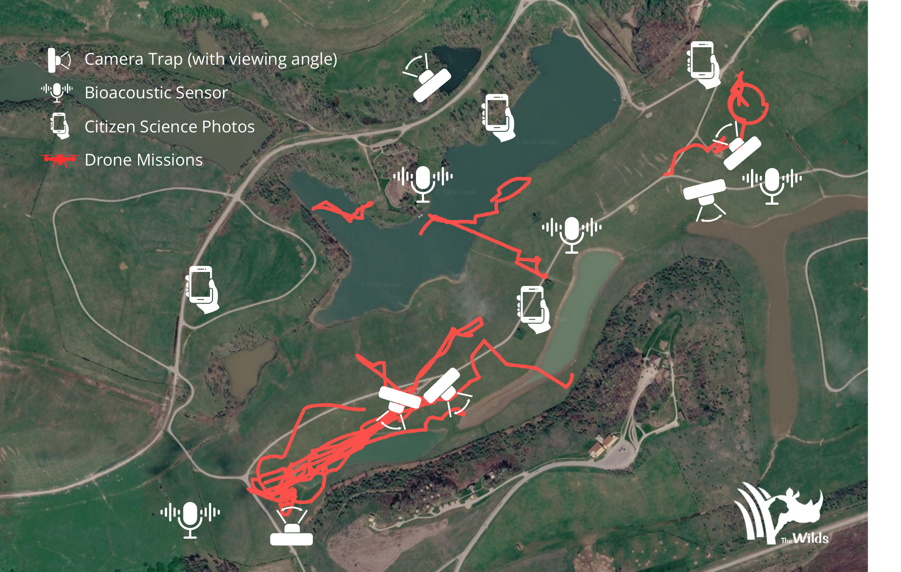
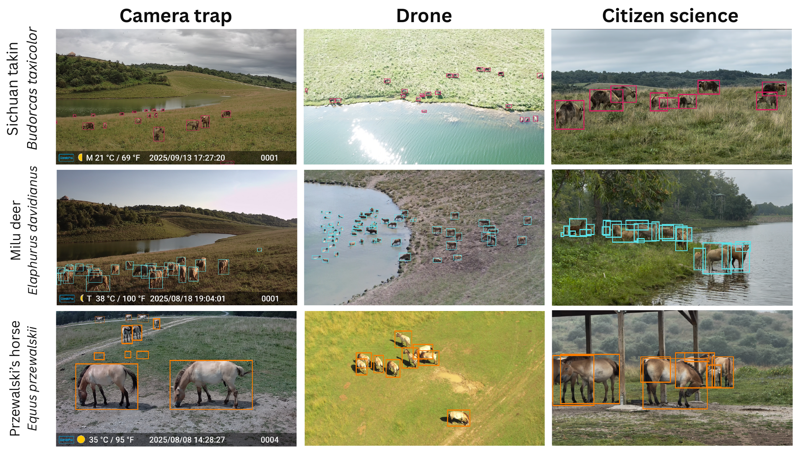

# Dataset Card for SmartWilds


*Sensor deployment across The Wilds: camera traps with viewing angles, Song Meter recorders, citizen-science photo locations, and drone flight tracks. Satellite imagery © Google.*


*The same three managed focal species (Sichuan takin, Milu deer, Przewalski's horse) observed by camera trap, drone, and citizen-science photography.*


**SmartWilds** is a multi-modal sensing dataset from three 2025 field campaigns
at The Wilds (Cumberland, Ohio). Each modality has its own dataset and DOI:

| Dataset | Content |
|---|---|
| [smartwilds-camera-traps](https://huggingface.co/datasets/ABC-Center/smartwilds_metadata/tree/main/smartwilds-camera-traps) | 235,778 processed images, 19,785 Events, 72,775 original-SAM3-geometry operational Occurrences; the 2,067-box reference set is separate |
| [smartwilds-bioacoustics](https://huggingface.co/datasets/ABC-Center/smartwilds_metadata/tree/main/smartwilds-bioacoustics) | 2,371 WAV recordings, 9,960 Occurrences |
| [smartwilds-drones](https://huggingface.co/datasets/ABC-Center/smartwilds_metadata/tree/main/smartwilds-drones) | 39 videos, 15 flight sessions, 318,215 Occurrences |
| [smartwilds-citizen-science](https://huggingface.co/datasets/ABC-Center/smartwilds_metadata/tree/main/smartwilds-citizen-science) | 1,103 media files, 622 Occurrences |
| **smartwilds** (this dataset) | study root, merged Event table, text records, arrival traces |

All five datasets share one Event hierarchy. The camera branch has its own
final Project and adds a per-image Event level:

```
TheWilds_2025 (study, 2025-06-30/2025-09-08)
├── SmartWilds_camera_traps_curated (Project)
│   └── SensorDeployment
│       └── Image
└── Other modality Projects
    └── SensorDeployment / flight session / observation session
        └── AudioRecording | MediaEvent
```

## Dataset Details

- **Curated by:** Jenna M. Kline, Anirudh Potlapally, Elizabeth G. Campolongo
- **Homepage:** <https://github.com/Imageomics/smartwilds> (documentation: <https://imageomics.github.io/smartwilds/>)
- **Paper:** SmartWilds: Integrating, Aligning, and Documenting Multi-Modal Field Sensing Data (under review)
- **Release build:** 2026-10-22, camera tables updated 2026-11-08

### Supported Tasks and Applications

The study-level tables support cross-modal and systems analyses that no single modality allows.

**🔗 Cross-Modal Analysis:**
- Joining camera, acoustic, drone, and citizen-science records by site, campaign, and time on one Event hierarchy
- Co-occurrence and corroboration of focal-species activity across sensors
- Sensor marginal value: which modality uniquely covers which places and hours

**⚙️ Sensing-Systems Research:**
- Campaign-2 arrival traces at acquisition and inference layers for workload characterization
- Synthesis of coordinated multi-modal workloads and hardware feasibility prediction (see the cross-modal coordination analysis)
- Burstiness as a function of modality and deployment topology

**🧹 Data-Quality and Metadata Research:**
- A 22-item defect inventory with detection family, repair, and residual risk for each defect
- Typed missingness and sentinel-value handling across modalities
- Standards crosswalk between Darwin Core, Humboldt, and sensor metadata

## Contents

- `data/events_all_modalities.csv`: all 22,242 Events, including the final
  camera Project, 12 SensorDeployments, and 19,772 per-image Events.
- `data/occurrences_all_modalities.csv`: 401,602 unique Occurrences. Every
  retained camera row joins to the merged Event hierarchy on `eventID`.
  
- `data/text_*.csv`, `data/site_selection_rationale.csv`: 30 text-derived
  Occurrences, plus the reasoning behind where each sensor was placed.
- `metadata/sensor_configurations.md`: per-device configurations for every
  modality.
- `analysis/arrival_traces_v2/`: Campaign-2 arrival streams at two layers.
  - Acquisition: one WAV recording per arrival.
  - Detection: one retained operational Occurrence per arrival. The camera
    trace uses the final 72,775 original-SAM3-geometry camera rows rather than
    the superseded first-generation camera output.

  Each stream comes with source-record IDs, inclusion rules, and checksums. The
  camera image-capture acquisition stream can be rebuilt from
  `smartwilds-camera-traps/data/images.csv`.
- `SUPPLEMENTAL.md`: the paper's supplemental material --- extended glossary,
  per-deployment inventories, all 18 timestamp-repair methods, drone ground
  projection, the standards crosswalk, typed missingness, model accuracy,
  validation checks, the field dictionary, arrival statistics, reproduction
  commands, and the full defect inventory.
- `metadata/DEFECT_INVENTORY.md` (and `defect_inventory.csv`): all 22 defect
  classes found during integration, each with its scope, what detected it,
  the repair applied, and the residual risk.
- `metadata/provenance/`: the final release audit.

## Licensing

Data: [CC0 1.0](https://creativecommons.org/publicdomain/zero/1.0/). Scripts: MIT.

## Citation

Cite the paper, plus each modality dataset you use. Dataset DOIs will be
assigned with the raw data release.

```bibtex
@article{kline2026smartwilds,
  author  = {Kline, Jenna M. and Potlapally, Anirudh and Campolongo, Elizabeth G.},
  title   = {SmartWilds: Integrating, Aligning, and Documenting Multi-Modal Field Sensing Data},
  year    = {2026},
  note    = {Under review}
}
```

This dataset card follows the [FAIR² Drones Data Standard](https://imageomics.github.io/fair_drones/)
(Kline and Campolongo, 2026).

## Acknowledgements

This project is supported by the [Imageomics Institute](https://imageomics.org), which is funded by the US National Science Foundation's Harnessing the Data Revolution (HDR) program under [Award #2118240](https://www.nsf.gov/awardsearch/showAward?AWD_ID=2118240) (Imageomics: A New Frontier of Biological Information Powered by Knowledge-Guided Machine Learning), and by the [AI Institute for Intelligent Cyberinfrastructure with Computational Learning in the Environment (ICICLE)](https://icicle.osu.edu/), which is funded by the US National Science Foundation under [Award #2112606](https://www.nsf.gov/awardsearch/showAward?AWD_ID=2112606).

This work is also supported by the AI and Biodiversity Change (ABC) Global Center. The ABC Global Center is funded by the US National Science Foundation under [Award No. 2330423](https://www.nsf.gov/awardsearch/showAward?AWD_ID=2330423&HistoricalAwards=false) and the Natural Sciences and Engineering Research Council of Canada under [Award No. 585136](https://www.nserc-crsng.gc.ca/ase-oro/Details-Detailles_eng.asp?id=782440). This dataset draws on research supported by the Social Sciences and Humanities Research Council.

Any opinions, findings and conclusions or recommendations expressed in this material are those of the author(s) and do not necessarily reflect the views of the National Science Foundation, Natural Sciences and Engineering Research Council of Canada, or Social Sciences and Humanities Research Council.

Special thanks to Dan Beetem and [The Wilds](https://www.thewilds.org/) in Ohio for providing access to deployment sites and supporting this wildlife monitoring research. We thank the Columbus Zoo and Aquarium for their support in facilitating this project. All data collection, including drone flights, was conducted under the supervision of the Director of Animal Management, with permission from The Wilds Animal Care and Use Committee.

This work used the [Ohio Supercomputer Center](https://www.osc.edu/) (Ohio Supercomputer Center. 1987. Ohio Supercomputer Center. Columbus OH: Ohio Supercomputer Center. <https://ror.org/01apna436>).

## Dataset Card Contact

Jenna M. Kline (kline.377@osu.edu)
